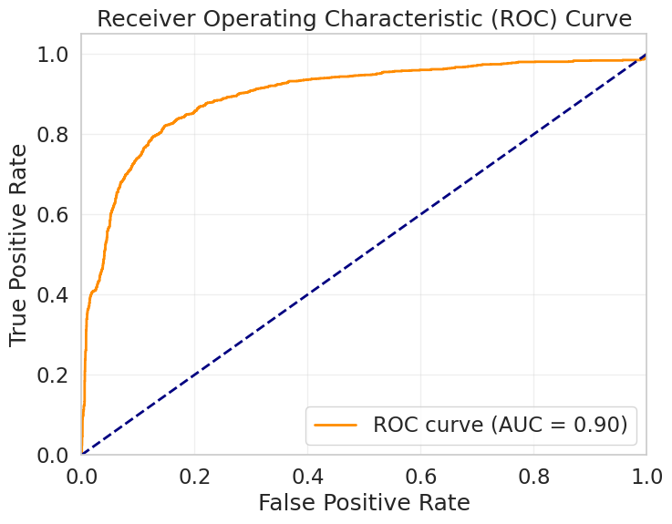

# Spam/Ham Email Classifier

Python coursework from **UC Berkeley DATA C100, Fall 2024**, preserved as two stages of an email-classification project. The notebooks contain recovered student code and written responses alongside the course's prompts and scaffolding.

| Stage | Actual implementation |
| --- | --- |
| [B1](notebooks/projB1.ipynb) | Binary substring-presence features; a five-word logistic-regression baseline; text EDA; precision, recall, and false-positive analysis. |
| [B2](notebooks/projB2.ipynb) | 24 hand-engineered features from body/subject text, keyword indicators, punctuation, capitalization, length, and vocabulary counts; `LogisticRegression(max_iter=500)`; prediction export and a training ROC curve. |

The data are split 90/10 with `random_state=42`. The retained final-model code fits and scores the 90% training portion; it does not report a held-out validation score. `GridSearchCV` and other optional tools are imported in the course setup, but the submitted implementation does not perform a grid search or cross-validation. The variable named `pipeline` is a logistic-regression estimator, not a scikit-learn preprocessing pipeline.

## Repository map

| Location | Purpose |
| --- | --- |
| [`notebooks/`](notebooks/) | B1/B2 submissions and the readable B2 compatibility helper. |
| [`scripts/`](scripts/) | Notebook-structure/syntax checks and synthetic feature checks. |
| [`assets/`](assets/) | Retained historical ROC figure. |
| [Data guide](DATA.md), [`requirements.txt`](requirements.txt) | Exact course-data expectations and runtime packages. |
| [Validation](VALIDATION.md), [sanitization](SANITIZATION.md), [provenance](PROVENANCE.md) | Evaluation limits, privacy cleanup, and source attribution. |

## Recorded results

These are **historical saved training outputs**, not a fresh evaluation:

| Model | Saved training accuracy |
| --- | --- |
| B1 five-word baseline | 75.762% |
| B2 engineered features | 88.606% |

The saved B2 ROC plot displays training AUC rounded to **0.90**. Its model-fitting output also contains an `lbfgs` convergence warning after the iteration limit. No exact test-set accuracy is present in these notebooks, so none is claimed here.



## Open or rerun

The saved code and figures can be reviewed without the dataset. To rerun, use Python 3.11 (the original notebooks recorded 3.11.10), install the packages in `requirements.txt` in your own environment, and obtain the exact course ZIP described in [DATA.md](DATA.md).

```bash
python -m pip install -r requirements.txt
python scripts/check_notebooks.py
python scripts/check_features.py
cd notebooks
python -m jupyterlab
```

Place `spam_ham_data.zip` in `notebooks/`. The code opens `train.csv` and `test.csv` inside that ZIP; do not substitute a different SpamAssassin split and expect identical outputs. Run B1 and B2 in separate fresh kernels from top to bottom. B2 exports local `predictions_*.csv` files; it does not submit them anywhere. Generated files and the dataset are ignored by Git.

`notebooks/projB2_utils.py` supplies the same `words_in_texts` function as the recovered B1 answer. This readable compatibility helper replaces the course distribution's Python 3.11 bytecode dependency. Package versions beyond the Python version were not captured, so the requirements are unpinned and exact numerical reproduction is not guaranteed.

## Preparation and limits

All 41 retained code cells pass Python syntax checks. The feature helpers also pass small synthetic-data checks without fitting a model. The full notebooks were not rerun because their dataset and complete scientific Python environment were not available in the preparation environment. See [VALIDATION.md](VALIDATION.md).

Student feature/model code and original written responses are preserved. Otter grading/export integration, automatic diagnostic-package installation, and saved raw-email previews were removed; retained metric outputs and plots are clearly marked as historical. The original B2 prose mentions scaling, but the actual model code does not apply `StandardScaler`. Detailed changes are recorded in [SANITIZATION.md](SANITIZATION.md) and [SANITIZATION.json](SANITIZATION.json).

The syntax and synthetic feature checks were recorded on **October 14, 2026**; this documentation refresh did not rerun them or fit a model. The final B2 implementation also retains two case-mismatched keywords (`Bonus` and `Project`) that do not match the lowercased text as written. The [validation record](VALIDATION.md) distinguishes these preserved details from the notebook's written claims.

## Private coursework archive

**Keep this repository private and do not share its solutions with current or future students.** The [Fall 2024 course collaboration policy](https://ds100.org/fa24/syllabus/#collaboration-policy-and-academic-honesty) prohibits sharing assignment answers and posting them publicly. This archive retains course attribution; [PROVENANCE.md](PROVENANCE.md) identifies the source material and upstream license. Private archiving does not grant broader redistribution rights.
